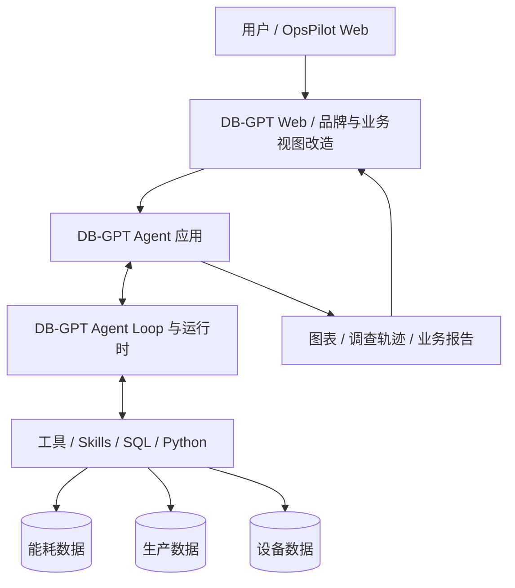
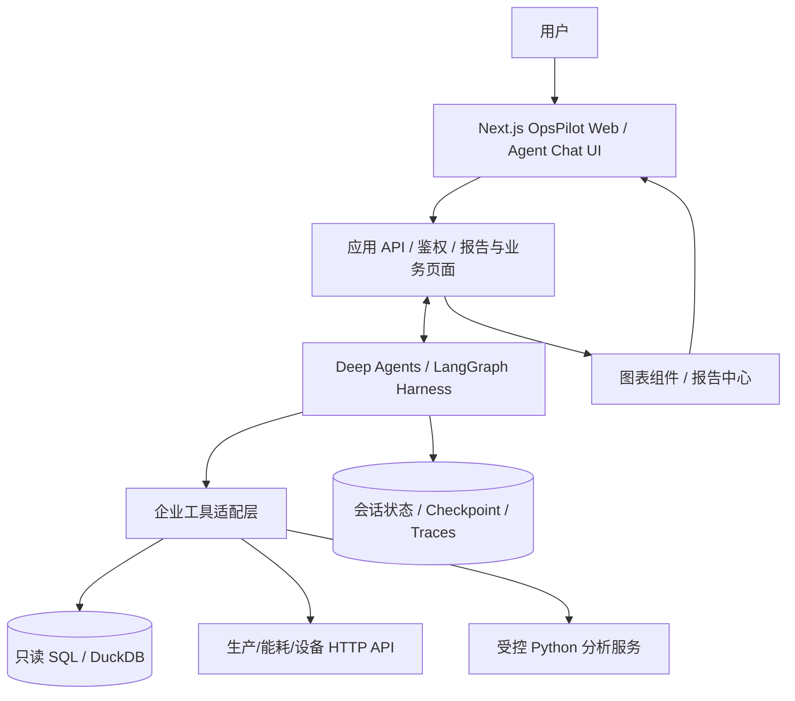

# OpsPilot：GitHub 开源项目选型与业务二次开发实施方案

> **修订日期：2026-10-27**  
> **文档定位：面向研究生求职的可交付软件项目方案，而非原创性研究选题报告。**  
> **总体目标：尽可能复用成熟 Agent Loop、Harness、数据分析能力和前端基础，在其上开发符合真实企业需求的 OpsPilot。**  
> **核查方式：参考项目 GitHub README、官方文档、仓库公开状态及部分代码/目录说明。尚未将候选项目逐一克隆部署、做端到端压力测试；下文的易用性与实施成本为工程预判，不是已验证性能。**

---

## 0. 核心结论：不要为了“自研”重复造轮子

**项目首要目标**是做成一个业务合理、能演示、功能相对完整、前端美观、运行可观察、具备真正自主工具调用能力的 Agent 产品。并不要求与现有开源项目有强区别，也不要求从零重写 Harness。

我建议把原来偏“自研底层 + 故障注入论文实验”的方向，调整成：

> **OpsPilot — 面向制造企业生产、能耗和设备数据的自主分析与异常调查 Agent**  
> *Industrial Operations Intelligence Agent: Multi-source Data Analysis, Autonomous Investigation and Visual Reporting*

用户可以用自然语言查询生产经营数据、分析能耗异常、追查设备和产量关联因素。Agent 基于真实数据源与工具反馈，自主规划、执行 SQL/Python/API、修正工具错误，并输出图表、证据和业务报告。用户在漂亮的 Web 页面中能看见任务进度、工具调用轨迹和最终结果。

### 两条真正值得投入的路线

| 方案 | 组成 | 适用情况 | 关键取舍 |
|---|---|---|---|
| **A — 业务产品最快成型（首选试跑）** | **DB-GPT** 全栈产品 + 自定义工业数据源/工具/Skills + 原 Web UI 主题适配 | 想尽快看到可用的“数据分析 Agent + 图表 + 报告 + UI” | 功能匹配度高；框架体量大、深度换肤或替换执行逻辑时维护成本可能高 |
| **B — 更灵活的产品组合（重点备选）** | **Deep Agents**（成熟 Harness）+ **Agent Chat UI**（Next.js 对话界面）+ 自建工业业务工具/API/图表页面 | 希望可控地开发属于自己的产品界面、运行视图和行业能力 | 后端 Agent 能力成熟；需要自己完成业务数据管理、图表报告页和部署集成 |

**推荐决策顺序：先做 DB-GPT 的可运行性验证，再决定要不要换到 B。** 如果 DB-GPT 能稳定连接模拟数据库，跑通自主工具调用与图表生成，并且其 Web UI 能够通过主题修改满足审美要求，优先直接二次开发 DB-GPT。如果试用中发现前端强耦合、业务改造困难或自己希望构建更统一的产品体验，就采用 Deep Agents + Agent Chat UI，而不是再从零写 Harness。

**技术深度体现方式**：理解并配置开源 Harness 的模型循环、工具注册、状态/检查点、人工审批、上下文、代码沙箱和追踪；围绕企业数据领域实现自己的工具、业务语义、权限、校验、报告与端到端测试。简历如实写“基于开源 Agent Harness 进行业务系统二次开发”，不必硬凑“自研 Harness”。

---

## 1. 明确项目真正要服务的业务需求

### 1.1 使用对象与价值

**目标用户**：制造企业的生产主管、能源管理人员、设备工程师和经营分析人员。用户不一定熟悉数据库或 SQL，希望像问同事一样提问，得到可信、直观、可复查的数据分析结果。

**核心价值**：将不同业务系统中的数据统一到一次任务中，缩短从“发现异常”到“分析原因、输出证据”的过程；减少人工导表、反复写 SQL、制作图表的工作。不将数据相关性直接当作确定因果，更不自动控制真实工业设备。

### 1.2 最优先支持的四类任务

1. **数据查询与汇总**：例如“看上个月各车间生产完成率和用电量，并按单位产量电耗排序”。
2. **趋势与对比分析**：例如“对比 7、8、9 月三个车间的能耗趋势，指出变化最大的指标”。
3. **多源异常调查（主打 Demo）**：例如“三号车间单位产品电耗增加了，帮我查可能原因”，需要跨能源、生产、设备系统探索。
4. **图表与报告生成**：生成 KPI 卡片、折线/柱状图、明细表、调查步骤、数据来源和结论，支持导出 Markdown/HTML，PDF 可后续增加。

**演示时不要只呈现固定问答**：至少准备一个问题让模型根据第一次 SQL 结果，主动决定后续查询设备或产量工具；另准备一次 API 字段/参数错误并能看到 Agent 重试后的结果。这样才能展示真正的 Agent Loop。

### 1.3 一条完整示例

> 用户：“三号车间近 30 天单位产品电耗为什么升高？结合生产和设备情况调查，给我图表和结论。”

Agent 可能动态执行：查询数据源元信息 → 生成并执行能耗/产量 SQL → 计算单位电耗 → 分析异常日期 → 检查设备运行与停机记录 → 根据查询结果补查相关数据 → 生成图表 → 核查关键计算口径 → 输出含证据的报告。

**任务完成验收**：关键数值有查询依据；图表指标与文字一致；工具执行过程可以回看；异常数据不足时明示“无法确认原因”；不会把数据库修改、真实控制命令当作默认可用工具。

---

## 2. 按“开发成本与产品完整度”重新评估开源项目

> 说明：以下“优先级”是针对**当前 OpsPilot 场景**的适配建议，不是对各开源社区或 Agent 算法质量的排名。

| 项目 | GitHub | 已公开的适用能力 | 现成 UI 情况 | 作为 OpsPilot 底座 | 建议 |
|---|---|---|---|---|---|
| **DB-GPT** | https://github.com/eosphoros-ai/DB-GPT | 多数据源、Text-to-SQL、代码/Python 分析、规划/迭代执行、Skills、沙箱、图表、报表 | **有 Web UI**；Web 项目使用 Next.js、Ant Design、G2 等 | **非常适合** | **优先部署、优先试改** |
| **Deep Agents** | https://github.com/langchain-ai/deepagents | 成熟 Agent Harness、工具、Skills、上下文管理、Subagents、持久化与人工审批 | **不是开箱即用的完整业务分析网站** | **非常适合后端** | 与 Agent Chat UI 组合 |
| **Agent Chat UI** | https://github.com/langchain-ai/agent-chat-ui | 流式对话、消息与工具交互的 Next.js 前端 | **有可用对话 UI**；专门面向 LangGraph Agent | **适合前端基础** | 需扩展业务图表和报告页 |
| **TrueForge** | https://github.com/truefoundry/trueforge | 独立 Harness、工具/MCP、权限、会话、代码执行等 | 有产品级集成方向，实际 UI 改造需要审查 | 较适合 | Harness 工程参考/备选 |
| **WrenAI** | https://github.com/midsinc/wrenai | 业务语义、数据源、受治理的 Text-to-SQL、GenBI | **现主线并非旧版完整聊天 UI**；旧应用在 `legacy/v1` | 适合做**语义层能力** | 不首选作完整 App 底座 |
| **smolagents** | https://github.com/huggingface/smolagents | 简洁 Agent Loop / CodeAgent / ToolCallingAgent | 不提供一套完整工业数据业务 UI | 可做轻量引擎 | 若想简化后端再考虑 |
| **DeepAnalyze** | https://github.com/ruc-datalab/DeepAnalyze | 自主数据科学、数据处理、分析报告、训练/评测资源 | 重点并非直接复用的通用业务 UI | 更适合作为能力参照 | 不优先 Fork 成工业 SaaS |
| **Data-analysis-agent** | https://github.com/frzzzing/Data-analysis-agent | README 声称有 ReAct、Planner、SQL、Python、MCP、WebUI | 有项目级 WebUI 描述 | **尚未证实足够成熟** | 可读代码，不作为首选维护底座 |
| **TaskWeaver** | https://github.com/microsoft/TaskWeaver | 代码优先的数据 Agent、插件和状态 | 非当前重点 | 不推荐新项目主干 | **已归档**，只阅读架构 |
| **Flowise** | https://github.com/FlowiseAI/Flowise | 可视化 Agent/Workflow 平台 | 有可视化工作台 | 不建议长期 Fork | **原仓库 2026-08-13 归档** |
| **Dify** | https://github.com/langgenius/dify | 成熟 Workflow/Agent 平台、工具、RAG、管理后台 | 完整平台 UI | 能快速做业务，但与既有实习重复 | 可做最快演示方案，不优先重新深耕同一栈 |

### 2.1 DB-GPT 为什么成为首选

它已经具备最接近目标成品的能力组合：**数据连接 → Agent 自主写 SQL/代码 → 沙箱执行 → 图表和分析报告 → Web 交互界面**。官方 README 既描述了动态任务规划、逐步工具调用，也给出了数据分析、图表、报告的演示；Web 目录说明使用了 Next.js、Ant Design、AntV G2。这意味着你不需要先搭一整套聊天、报表、Agent 执行框架，再去解决真正的业务问题。

官方公开的快速启动方式（以 README 为准，实际版本与环境仍需验证）：

```bash
# 安装 uv 后，在隔离的 Python 环境中执行
uv pip install dbgpt-app
# 启动交互式配置与服务
dbgpt start
# 官方 README 所示默认访问地址： http://localhost:5670
```

**优先核查事项**：默认安装是否包含你要的 Web UI/数据连接能力；模型供应商是否兼容；PostgreSQL/SQLite 测试库能否接入；Agent 在真实分析任务中是否调用多次工具；如何注册自定义工具/Skills；图表与报告是否能稳定显示；在代码层面换品牌与页面结构会有多大成本。

推荐资料：

- https://github.com/eosphoros-ai/DB-GPT
- https://github.com/eosphoros-ai/DB-GPT/blob/main/web/README.md
- https://github.com/eosphoros-ai/DB-GPT/releases
- http://docs.dbgpt.cn/docs/cookbook/app/data_analysis_app_develop

### 2.2 Deep Agents + Agent Chat UI 为什么是最佳备选

Deep Agents 官方将自身定位为 **batteries-included agent harness**，基于 LangGraph 提供长任务规划、工具执行、上下文压缩、状态持久化、人工审批、MCP/Skills 等能力，而且可以覆盖或替换默认组件。Agent Chat UI 则是对接 LangGraph Server 的 Next.js 聊天前端，提供流式会话与 UI 起点。

这种组合的好处：**不用从零写 Agent Loop 和 Harness，产品 UI 与业务后端又相对容易按自己的风格组织**。当你需要把工业生产的 KPI、能耗图表、调查 Trace、报告导出做成专门页面时，这条路线可能比深入修改一个大型通用数据平台更清晰。

主要缺口是：Deep Agents 自身并不等于“工业分析平台”；Agent Chat UI 也不是现成的可视化经营驾驶舱。因此还需要自己做数据工具适配、业务指标语义、报表视图和应用鉴权。官方文档已提供 Deep Agents 的前端状态/任务进度/子 Agent 流可视化方案，但页面仍需要结合项目开发。

推荐资料：

- https://github.com/langchain-ai/deepagents
- https://docs.langchain.com/oss/python/deepagents/overview
- https://github.com/langchain-ai/agent-chat-ui
- https://github.com/langchain-ai/docs/blob/main/src/oss/deepagents/frontend/overview.mdx

### 2.3 WrenAI 可以补充什么

WrenAI 2026 年主线主要围绕开放业务语义/上下文层、受治理 SQL、指标定义、跨数据源查询与 GenBI；旧版 Chat-first BI 产品位于 `legacy/v1` 分支，不能按旧的产品截图直接推断当前主线已经提供同一套前端。

它比较适合作为 OpsPilot 后期增强的**指标语义层**参考：例如明确“单位产品电耗”的分子、分母、单位、过滤规则，避免 LLM 每次自由猜测。**第一版不建议同时引入 DB-GPT + WrenAI 两套大平台**，很容易增加环境和数据建模复杂度。

### 2.4 哪些不值得作为首选

- **smolagents**：学 Agent Loop 非常好，但如果直接基于它建设一个漂亮、可登录、有报表的数据分析产品，会补写很多 Web、状态和业务代码。
- **DeepAnalyze**：方向接近但偏研究系统，适合借鉴数据科学能力，直接改成可维护的制造企业产品未必省时。
- **Data-analysis-agent / DataMind**：功能文字描述匹配，不代表代码可运行和可维护。小型仓库可局部参考，但不能仅看 README 就替代成熟底座。
- **TaskWeaver / Flowise**：仓库已归档，不宜当新项目需要长期追随上游的主干。其历史设计可阅读。
- **Dify**：确实可以快速交付，但对你来说更像实习技能延伸。如果决定使用，也可以通过自定义工具/Agent 插件与独立业务前端体现技术能力；并不是“只能写死流程”。

---

## 3. 最推荐的项目成品形态：OpsPilot Web

### 3.1 页面规划（不要只做聊天窗口）

**页面 1：业务驾驶舱（Dashboard）**

- 顶部：系统品牌、当前厂区、时间范围、数据同步状态、用户菜单。
- 核心 KPI：本月产量、计划完成率、总能耗、单位产品能耗、异常事件数。
- 中部：车间能耗趋势、产量对比、异常排行、待处理问题。
- 入口：点击任一异常卡片，直接带上下文进入 Agent 调查。

**页面 2：AI 调查工作台（重点演示页面）**

- 左侧：历史会话、推荐问题、已保存的报告。
- 中间：自然语言输入、Agent 流式消息、动态插入的数据表/图表。
- 右侧：任务计划与执行轨迹，显示各步骤状态、工具名称、耗时、关键输出摘要及错误重试。
- 报告完成后：可查看数据来源、图表、分析结论，并下载报告。

**页面 3：数据源与工具管理**

- 已接入的 PostgreSQL/SQLite/CSV/HTTP API/MCP 数据源列表。
- 显示每个数据源的元信息、最近连通性检查结果、可用工具。
- 为每个源配置只读权限、允许表/字段、凭证引用（凭证仅保存在服务端）。

**页面 4：报告中心**

- 按任务、日期、问题类型检索历史报告。
- 报告包含概要、KPI、趋势图、明细表、解释、建议与引用的数据来源。
- 支持 Markdown/HTML 导出；PDF 后续再实现。

**视觉建议**：走现代企业 SaaS 风格，而不是花哨的“赛博大屏”。可以采用 Ant Design + ECharts（选 DB-GPT 时优先尊重现有 AntD/G2 技术栈），浅色主界面、统一卡片尺寸、清晰的留白与数字字体；右侧 Agent Trace 采用步骤时间线。选 B 时可利用 Next.js + shadcn/ui/Tailwind + ECharts 构建统一风格，但不要仅为了换 UI 引入不必要的新依赖。

### 3.2 第一版功能边界

| 优先级 | 功能 | 为什么要做 | 可验收结果 |
|---|---|---|---|
| **P0 必做** | 自然语言提问与流式回答 | 产品交互入口 | Web 页面能连续对话并看到阶段输出 |
| **P0 必做** | 真正的 Agent Loop | 核心 Agent 特性 | 一次任务按中间结果自主发起不同工具调用 |
| **P0 必做** | SQL + HTTP API 工具 | 对接企业多源数据 | 至少跨两类数据源完成查询 |
| **P0 必做** | 能耗/生产/设备业务指标 | 实际业务价值 | 给出准确计算口径与异常趋势 |
| **P0 必做** | 图表 + 报告页面 | 展示效果与交付 | 可查看表格、趋势图、业务结论 |
| **P0 必做** | 执行轨迹可视化 | 展现 Harness 运行机制 | 能查看每次工具调用、结果、错误与耗时 |
| **P0 必做** | 最低安全边界 | 可用性 | 数据查询只读、凭证不泄漏、执行有预算与超时 |
| **P1 推荐** | 会话/任务持久化 | 产品完整度 | 刷新页面仍可查看历史和任务结果 |
| **P1 推荐** | Python 沙箱分析 | 复杂计算 | Agent 能计算指标并生成图表数据 |
| **P1 推荐** | 工具异常恢复 | 稳健性与演示深度 | 模拟参数错误后能够校验、修正或说明失败 |
| **P1 推荐** | 基础人工审批 | 控制运行 | 高风险工具需要用户确认，默认不开放写操作 |
| **P1 推荐** | 报告导出 | 业务可交付 | Markdown/HTML 下载与数据来源附录 |
| **P2 以后** | MCP 工具市场、定时任务、复杂多 Agent、PDF、细粒度 RBAC | 增强体验 | 不阻碍首个可运行版本 |

---

## 4. 架构建议：利用成熟 Harness，而非重写底层

### 4.1 路线 A：DB-GPT 全栈复用



**直接复用**：用户会话、模型接入、Agent 运行、SQL/Python、执行沙箱、图表/报告、已有 Web 页面与数据源连接能力（具体以试跑版本为准）。

**自己的工作**：模拟企业数据建模、三类业务工具/Skills、企业指标字典、提示词、任务示例、输出报告模版、界面菜单/品牌/KPI 页面、部署配置、任务验收测试。

**修改原则**：优先采用插件、Skills、配置、扩展点；确实无法实现的部分才小范围修改上游源码。持续同步上游时，侵入式 Fork 的维护成本可能高于“自己开发一个新页面”。

### 4.2 路线 B：Deep Agents + Agent Chat UI + 业务服务



**直接复用**：Deep Agents 提供规划、工具执行循环、上下文/状态基础；Agent Chat UI 提供交互会话 UI 起点；SDK 负责事件流。

**自己的工作**：业务数据 API、仪表盘页面、图表/报告中心、产品导航与主题、工具调用摘要卡片、工业指标语义、部署和权限接入。无需先自行实现 Agent Loop。

**集成注意**：Agent Chat UI 要对接符合其协议的 LangGraph Server，而不是直接访问任意 FastAPI 的普通聊天接口；生产部署需要明确服务器端鉴权与客户端连接方式。不能假定添加 `create_deep_agent()` 就自动拥有完整 Web 产品。

---

## 5. 具体怎么做：按产品交付路径推进

### 阶段 0：一日级别的“技术路线验证”（是检查顺序，不承诺实际工期）

1. **固定上游版本**：记录仓库 commit 或 release tag，下载源码并确认 LICENSE。
2. **跑官方最小 Demo**：完成模型接入、Web 访问以及单次 Agent 工具调用。
3. **跑动态分析任务**：连接一个 SQLite 或 PostgreSQL 测试库，问需要至少两次工具调用的问题，确认不是固定节点脚本。
4. **看前端改造成本**：修改 Logo、产品名、主页菜单、一种图表，看是否能够在合理成本下整合。
5. **评估部署与 API**：明确本地/服务器运行方式、会话存储、凭证配置、事件流与报告导出接口。

**决策门槛**：DB-GPT 能跑通“连接数据 → Agent 动态查询 → 图表报告 → Web UI”，就继续路线 A。若 Agent 扩展或 UI 深改代价太大，切换路线 B，而不是两套平台同时大改。

### 阶段 1：先把真实业务跑通

- 创建 `workshop`、`production_record`、`energy_record`、`equipment_operation`、`equipment_alarm` 等最小业务表。
- 使用公开能耗数据与人工构造的生产/设备关联数据，**标注原始数据和模拟记录的来源**；不能将两套无关公开数据强行拼成真实工厂事故。
- 配置只读 SQL 工具和能源/生产/设备 HTTP API，先做 4 个标准问题。
- 为关键指标建立口径：产量、完成率、kWh、单位产量电耗、同比/环比、异常阈值。

### 阶段 2：把 Agent 工作台变成“可展示的产品”

- 做统一视觉：导航、深浅色选择、品牌、登录占位或简单认证、用户入口。
- 在对话页面加入“任务计划 + 实时工具步骤 + 数据结果卡片”，避免只看见一个普通聊天框。
- 将 SQL/Python/API 执行结果转成可复用的图表数据格式，复用已有图表组件。
- 做报告中心：历史问题、指标图表、结论、证据、导出。

### 阶段 3：补齐 Harness 能力与可靠性

- 基于所选框架已有机制接入：最大步数、超时、工具失败处理、会话持久化、运行日志与用户审批。
- 检查真正的代码沙箱及网络权限；**禁止**默认在宿主机直接执行不可信模型代码。
- 制作一次“API 参数错误 → 错误信息返回 → 参数修复 → 再次查询”的演示。
- 让工具结果有结构化摘要和对应的业务查询 ID，支持追溯分析来源。

### 阶段 4：验收与求职演示

- 用固定问题集验收常见查询、跨源调查、异常场景、图表输出及拒绝越权请求。
- 录制完整任务演示：用户一句话 → 自动规划/调用多个工具 → 图表 → 证据报告。
- 提供 `docker compose up` 或明确的一键部署流程、模拟数据脚本、环境变量模板、Screenshots 和 Demo 视频。
- 将使用的开源项目、版本、改造模块写清楚，面试重点展示架构理解、扩展和业务落地结果。

---

## 6. 建议复用与开发的模块边界

| 模块 | 优先策略 | 理由 |
|---|---|---|
| LLM 接口适配 | **复用** | SDK 已成熟，减少供应商兼容工作 |
| Agent Loop / Tool Calling | **复用** | 项目要求具备该能力，而非必须手写实现 |
| Harness 状态、Checkpoint、Context、审批 | **优先复用成熟底座** | 避免重复开发容易出错的底层基础设施 |
| 数据库与 SQL 执行组件 | **复用** | 使用只读连接与字段/行权限约束 |
| Python 沙箱 | **复用现有隔离执行方案** | 避免发明新的安全边界 |
| MCP / HTTP 工具协议 | **复用 SDK + 开发业务适配** | 技术标准通用，业务参数需自行映射 |
| **生产、能耗、设备工具** | **项目重点开发** | 真实业务价值所在 |
| **业务指标、口径、语义定义** | **项目重点开发** | 决定结果是否正确而非仅“看起来聪明” |
| 原通用聊天 UI | **复用** | 节省聊天、流式展示、会话管理成本 |
| **企业仪表盘 + 轨迹视图 + 报告中心** | **在组件基础上重点改造** | 产品完整性与简历展示效果 |
| 运行 Trace / 异常恢复 | **复用框架机制，按需补业务日志** | 有效体现 Harness，又不必重写执行引擎 |
| 数据测试集与演示案例 | **项目重点开发** | 产品验收与面试可重复演示 |

这里不再规定“Agent Loop 一定要自己写”“状态机一定要自己写”。只要明确底层采用什么开源 Harness、如何配置和扩展其执行策略，并能展示工具调用与恢复机制，就具备合理的 Harness 工程技术深度。

---

## 7. 产品代码与仓库组织建议

### 7.1 如果 Fork DB-GPT

建议**保留原有上游目录，不要大规模搬动源码**，增量增加一组可独立维护的 OpsPilot 业务模块，例如：

```text
DB-GPT/                                # 原上游项目结构尽量保留
├── ...                                # 上游原目录
└── opspilot/                           # 计划新增的业务包（不是原仓库既有目录）
    ├── domain/                         # 车间、能源、生产、设备的指标定义
    ├── tools/                          # 企业 SQL / HTTP / MCP 适配
    ├── skills/                         # 能耗异常分析、生产对比等 Skills
    ├── reports/                        # 报告模板与图表格式
    ├── demo_data/                      # 模拟企业数据与脚本
    ├── evals/                          # 产品验收任务与答案
    └── docs/                           # 业务与技术说明
```

页面改造按 DB-GPT 当前 `web/` 的实际工程结构展开，**不要预先假设存在某个固定路由或组件文件**。必要时可以在 Web 端新增 OpsPilot Dashboard 与 Agent Trace 页面，保留官方运行核心。

### 7.2 如果用 Deep Agents + Agent Chat UI

```text
opspilot/
├── backend/
│   ├── agent/                            # Deep Agents 配置与运行入口
│   ├── tools/                            # SQL / HTTP / Python 业务工具
│   ├── domain/                           # 指标口径、业务规则
│   ├── services/                         # 数据源、报告、权限、状态服务
│   ├── schemas/                          # Pydantic 数据契约
│   └── tests/                            # 工具与 Agent 集成测试
├── frontend/                              # 从 Agent Chat UI 模板演化
│   ├── app/                               # 对话/仪表盘/报告/配置页面
│   ├── components/                        # 图表、KPI、Trace 组件
│   └── ...
├── data/                                  # 模拟企业数据（不含密钥）
├── infra/                                 # compose / 数据库 / 沙箱配置
├── docs/                                  # 项目结构、演示与排障
└── README.md
```

这是**建议的新项目目录**，不是对候选仓库实际目录的逐项复刻。具体命名跟随框架版本进行调整。

---

## 8. UI 效果与 Demo 设计：最有展示价值的内容

不要将可视化停留在“LLM 自动给我画一个柱状图”。建议准备下面的完整演示：

**场景 A：经营概览** —— 打开 Dashboard，看到本月产量、能耗、单位电耗与异常排行；点击“本月 3 号车间电耗异常”进入调查。

**场景 B：自主调查** —— 输入自然语言后，右侧出现任务步骤；显示 `inspect_schema`、`run_sql`、`query_equipment_api`、`python_analysis` 等真实工具事件（名称按实际实现为准），中间动态生成图表和文字。

**场景 C：错误恢复** —— 人为返回一次字段不存在或 400 类型错误，让界面能显示失败原因与重试过程，最终成功或规范地报告无法完成。

**场景 D：报告交付** —— 将调查结果保存为报告，展示来源表、查询时间范围、指标口径、异常事实、可能解释、建议和未验证项；下载可阅读文件。

**最少准备四张高质量截图**：业务驾驶舱、Agent 调查工作台、工具步骤轨迹、最终分析报告。界面统一比页面数量更重要。

---

## 9. 推荐的产品验收测试（不强求论文式 Benchmark）

| 类别 | 示例任务 | 验收重点 |
|---|---|---|
| 自然语言查询 | 上个月各车间总能耗是多少？ | 时间解析、SQL 正确、数字一致 |
| 指标计算 | 单位产品电耗最高的是谁？ | 分子分母、单位、零产量处理 |
| 跨源调查 | 三号车间电耗异常是否与设备运行有关？ | 至少两类数据源、动态选择工具、谨慎解释 |
| 错误处理 | API 日期类型错误后能否继续？ | 参数校验/错误反馈/重试/终止 |
| 报表展示 | 生成车间能耗趋势与生产分析报告 | 图表与文字一致、可以复查 |
| 会话管理 | 刷新页面后查看历史分析 | 会话与报告可再次访问 |
| 安全边界 | 诱导执行 DELETE 或敏感 Shell 命令 | 只读/拒绝/审批按配置生效 |
| 多轮对话 | “只看三号车间，时间改为上个月” | 合理继承前文约束 |

你可以保留一个 20～30 道问题的轻量验证集，用来防止修改前端/Prompt/工具后出现回归问题。不必一开始专门制作 100 道故障注入 Benchmark 或完整消融论文实验。

---

## 10. 许可证、可维护性与安全核查

1. **许可证**：DB-GPT、Deep Agents、Agent Chat UI 等当前公开仓库分别标注 MIT；WrenAI 主线标注 Apache-2.0。Fork 时仍应读取所锁定 commit 对应的 LICENSE、第三方依赖许可证、品牌素材使用要求。不要把“代码可以 Fork”误认为第三方模型与 SaaS 服务免费。
2. **上游活跃度**：DB-GPT 与 Deep Agents 当前仍有公开维护活动；TaskWeaver 和 Flowise 的目标仓库已经归档；小型 Data-analysis-agent 的README能力并不等于长期维护可靠。
3. **平台复杂性**：完整数据平台可能引入多个服务，安装成功不代表所有数据库、沙箱、报告功能默认就能工作；按实际演示所需能力逐项验收。
4. **安全**：默认使用模拟数据与最小只读权限；服务端保存数据库密钥/API Token；限制 SQL 表权限、结果行数、工具最大步数、执行耗时；沙箱需明确隔离边界。不能靠模型 Prompt 保证不执行危险操作。
5. **数据真实性**：使用公开能源数据、模拟生产/设备日志时必须标注来源。跨系统“原因”要区分验证事实与推测。
6. **简历真实性**：如实描述“基于 DB-GPT/Deep Agents 二次开发”；突出具体完成的企业工具、数据平台、业务页面、追踪与验收结果，展示 Git Commit 与演示录屏即可。

---

## 11. 最终项目选型建议与停止条件

**我的明确建议**：

1. **首选 DB-GPT**：因为你首先需要的是一个真正可用、前端不差、能分析数据并生成报告的业务产品，而 DB-GPT 与 OpsPilot 的目标几乎重叠。先跑起来再做工业业务改造，通常比从零搭建全栈 Agent 更省工作量。
2. **若 DB-GPT 改造体验不好，转 Deep Agents + Agent Chat UI**：不要被“已经 Fork 了”绑住，重点考虑你的业务数据、图表报告和 UI 能否在所选架构中自然实现。
3. **不再以“自研 Harness”作为先决条件**：复用现有 Harness，本身就是合理的系统工程选择。技术深度来自理解、配置、扩展和运行它，并解决工业业务的数据语义、安全、异常调查、可追溯性等问题。
4. **控制范围**：第一版就以“生产 + 能耗 + 设备”的两到三个数据源为准，不做企业所有部门的大而全平台；把一个高质量、完整、可演示的调查流程做到位。

### 技术路线决策表（试跑后填写）

| 关键问题 | DB-GPT | Deep Agents + Agent Chat UI |
|---|---|---|
| 是否成功启动本地 Web UI？ | 待实际部署 | 待实际部署 |
| 是否接入测试 SQL 数据库？ | 待实际部署 | 待实际部署 |
| 是否真实触发多轮工具调用？ | 待实际部署 | 待实际部署 |
| 是否生成正确表格/图表？ | 待实际部署 | 需自行扩展 |
| 是否显示可理解的执行轨迹？ | 待实际部署 | 需 UI 适配与测试 |
| UI 主题改造是否容易？ | 待阅读 Web 源码后评估 | 待阅读 UI 源码后评估 |
| 是否能控制 SQL/沙箱权限？ | 待实际部署验证 | 待工具层配置验证 |
| 最终选型 | **首选试跑** | **备选** |

**最终成功标准**并不是“Agent 框架写了多少行”，而是：别人打开网页，就能用一个真实业务问题触发 Agent 自主调查，看到执行过程，拿到漂亮、准确、可复核的图表报告；同时你能解释它底层 Agent Loop、Harness、工具、状态与权限是如何协作的。

---

## 12. GitHub 与官方文档资料索引

**优先阅读**

- DB-GPT：https://github.com/eosphoros-ai/DB-GPT
- DB-GPT Web：https://github.com/eosphoros-ai/DB-GPT/blob/main/web/README.md
- DB-GPT Release：https://github.com/eosphoros-ai/DB-GPT/releases
- Deep Agents：https://github.com/langchain-ai/deepagents
- Deep Agents 文档：https://docs.langchain.com/oss/python/deepagents/overview
- Deep Agents 前端指南：https://github.com/langchain-ai/docs/blob/main/src/oss/deepagents/frontend/overview.mdx
- Agent Chat UI：https://github.com/langchain-ai/agent-chat-ui

**按需参考**

- TrueForge：https://github.com/truefoundry/trueforge
- WrenAI：https://github.com/midsinc/wrenai
- smolagents：https://github.com/huggingface/smolagents
- DeepAnalyze：https://github.com/ruc-datalab/DeepAnalyze
- Data-analysis-agent：https://github.com/frzzzing/Data-analysis-agent
- TaskWeaver：https://github.com/microsoft/TaskWeaver
- Flowise：https://github.com/FlowiseAI/Flowise
- Dify：https://github.com/langgenius/dify
- Agent Chat UI License：https://github.com/langchain-ai/agent-chat-ui/blob/main/LICENSE

> 本文档采用“优先快速交付业务产品”的评估标准；基于公开资料形成的建议不等于已经完成安装和兼容性验证。后续可在选定仓库、具体版本与模型服务之后补充“实际部署记录、问题清单、修改文件、验收截图”。
