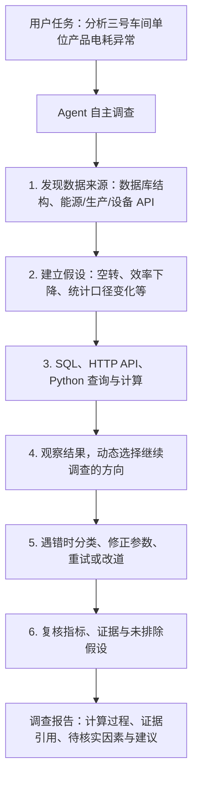
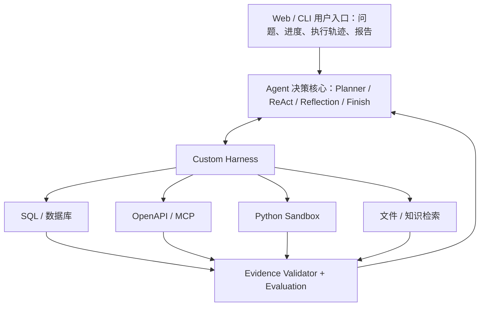

# OpsPilot：面向复杂业务数据的自主调查与分析 Agent

> 原回答完整整理版（Markdown 文档）。保留前一条回答的全部章节、论述、技术选型、开发计划和评测方案；原聊天中的视觉卡片和流程图已转换为 Markdown 表格与 Mermaid 图，方便持续学习和版本管理。文中的项目成果为**计划目标，不代表已经实现**。

结合你的研究生背景、脑电情绪识别研究经历，以及在企业实习期间积累的 Dify、RAG、MCP、生产数据查询、能耗分析、智能报表等项目经验，我认为你现在最值得做的，不是再开发一个普通的 AI 助手，而是：

**以真实企业业务问题为切入点，独立开发一个具备 Agent Loop、自研 Harness、动态工具调用、任务规划与自动纠错能力的 Data Agent。**

我的首选方向是：

**OpsPilot：面向复杂业务数据的自主调查与分析 Agent**  
**Autonomous Data Investigation Agent with Custom Harness**

一套能够理解自然语言问题、自主探索数据库和 API、编写分析代码、验证假设、修复执行错误并生成可追溯分析报告的通用数据调查智能体。

| 维度 | 设计定位 |
|---|---|
| 核心技术 | **Agent Loop + 自研 Harness** |
| 执行范式 | **ReAct + 动态规划** |
| 应用场景 | **企业数据异常调查** |
| 项目目标 | **自主执行 + 可验证结果** |

## 一、为什么我推荐这个方向？

先从求职市场和技术研究方向来判断。

2026 年 10 月 14 日，上海人工智能实验室发布的 Data Agent 相关岗位要求，明确涉及动态规划、工具语义检索、任务自动执行、错误修复、上下文与状态管理、运行轨迹采集及评测体系。美团的 Agent 研发岗位也要求理解 Planner、Executor、Evaluator 以及 Agent Framework 的核心组件。这些岗位属于招聘需求参考，并非全部面向应届生，但能反映目前工程技术关注点。

我将适合你的项目方向归纳为四类：

| 项目方向 | 技术深度 | 与已有经历的契合度 | 独立完成可行性 | 推荐度 |
|---|---|---|---|---|
| 通用 Coding Agent（类 Codex） | 很高 | 中 | 中 | ★★★★ |
| **Data Agent + 自研 Harness** | **很高** | **很高** | **高** | **★★★★★** |
| 自主科研 Agent（Auto-Research） | 很高 | 高 | 中偏低 | ★★★★ |
| 企业通用办公 Agent | 中高 | 高 | 高 | ★★★ |

我最看重第二个方向，原因有三个。

**第一，你有真实的需求理解，不必凭空设计业务场景。** 你之前在生产数据、能耗分析等任务中遇到过 API 参数不统一、模型工具调用失败、结果结构变化、权限错误等问题。这些恰好可以转化成新项目的 Harness 工程能力，而不只是重复原来的 Dify 工作。

**第二，它能体现从“搭建 Agent 应用”到“开发 Agent 底层系统”的技术升级。** 原来的实习经历证明你会运用平台解决企业问题，新项目则可以证明你理解模型与环境之间的交互机制，能够自己实现运行循环、工具调度、上下文和状态管理、执行恢复与评测。

**第三，它同时适合 AI Agent 开发、LLM 应用开发、AI 工程与部分平台研发岗位。** 你不必与 Codex、Claude Code 竞争通用代码生成能力，而是利用代码执行能力，解决一个具有清晰业务价值的非纯编码问题。

最重要的是：这个项目不是一个“用户提问 → 自动查询数据 → LLM 生成报表”的系统。它真正要解决的需求是：

**当用户只描述一个异常现象、没有提供完整调查步骤时，Agent 能否像数据分析工程师一样，自主决定调查路径，调用不同工具收集证据，不断验证和修正判断，最后给出可验证的结论？**

这才是能充分体现 Agent Loop 和 Harness 的需求点。

## 二、项目究竟做什么？用一个真实场景说明

假设一家制造企业有生产管理系统、能源管理系统和设备管理系统。现在管理人员提出一个问题：

> 最近一个月，三号车间的单位产品电耗明显增加，但产量没有明显变化。请帮我调查原因，并给出证据和改进建议。

传统的数据查询 Agent 可能只查询月度能耗数据，再生成一份文字分析。

而你要开发的 OpsPilot，应该能够自主完成一场调查。



这个过程中，开发者并没有写死“先查能源表，再查设备表，再查生产表”的顺序。Agent 可以在任务执行过程中决定下一步调用什么工具。

而如果调用出错，它不应该立刻停止，而应该能够分析错误、调整工具参数或改变调查路线。这正是 ReAct、Agent Loop 和 Harness 能发挥价值的地方。

需要注意，数据相关性不等于因果关系。系统应区分“已验证的事实”“支持某种解释的证据”和“尚未证实的原因”，不能仅凭电耗与设备负荷同时上升就断言存在因果关系。

## 三、系统架构怎么设计？

我建议将项目划分为三层：自研 Agent 决策循环、自研 Harness、可插拔的数据与工具环境。



Harness 内部需要覆盖 **Agent Loop 控制器、Tool Registry / Router、Context & Memory、State / Checkpoint、Permission & Sandbox、Error Recovery、Tracing / Replay、Budget / Timeout**。

这套架构的核心创新点不在于画出了多少组件，而在于你需要亲自实现并验证以下能力。

### 1. 自研 Agent Loop

基于你前面学习的 `run_agent()`，进一步实现：

- 根据模型返回的 Function Calling 请求动态调用工具。
- 工具执行后将 Observation 写入上下文。
- 支持 ReAct 式循环，以及可选的 Plan-and-Execute。
- 判断任务完成、执行失败、需要人工确认等不同状态。
- 控制最大迭代次数、Token 消耗和运行时间。

初期只做**一个通用 Agent**，不建议急着拆成 Planner Agent、SQL Agent、分析 Agent 等多个角色。多 Agent 并不是衡量 Harness 技术深度的必要条件。

### 2. 自研 Harness：项目最重要的技术部分

这里是你与普通 Dify 项目拉开差距的地方。

| 核心模块 | 需要解决的实际问题 |
|---|---|
| Tool Registry | 自动发现、注册和描述工具，支持运行时选择 |
| Tool Executor | 统一执行 SQL、API、Python、MCP 等调用 |
| Context Manager | 管理历史消息、长工具输出与 Token 预算 |
| State Manager | 保存当前任务进度，支持暂停和继续 |
| Error Recovery | 处理工具执行失败，支持重试和模型自主纠错 |
| Sandbox | 在隔离环境执行模型生成的代码 |
| Tracing | 记录模型调用、工具输入输出、异常和运行耗时 |
| Evaluator | 验证最终结果是否满足任务目标 |

其中最值得突出的三个模块是 **Tool Executor、Error Recovery 和 State Manager**。

例如，你之前遇到的 API 日期参数要求 `LocalDate[]`，而模型生成了不符合要求的字符串数组。在这个新项目中，不应该再为每个接口写死大量参数规整逻辑。

可以设计成：

```text
模型自主发现 OpenAPI 接口
          ↓
读取接口 Schema
          ↓
生成工具调用参数
          ↓
Harness 校验数据类型
          ↓
执行 HTTP 请求
          ↓
后端返回 400 类型错误
          ↓
错误分类与修复反馈
          ↓
LLM 修正参数后重新调用
```

这还可以进一步发展为 OpenAPI 到工具定义的自动转换机制。这样，新接入一套业务系统时，不需要重新编写整套执行流程。

但错误恢复必须有边界：参数校验和已知错误的确定性修复应优先由程序完成，只有需要语义判断的错误才交给 LLM；避免模型无限尝试同一个失败操作。

### 3. 受控 Python 执行环境

这一部分能够把你之前提出的“利用编码能力扩展 Agent 功能”的思想真正落地。

例如，当系统没有专门的“能耗异常分析工具”时，Agent 可以自主生成 Python 代码，使用 Pandas 分组统计、计算变化率、查找异常区间并绘图。

但是这类代码应该运行在限制网络、文件访问、CPU、内存及执行时间的隔离环境中。生产数据库使用只读账户，涉及修改业务数据的操作默认禁止。OpenAI 的 Harness 和 Sandbox 架构也强调将可信控制层与模型驱动的代码执行环境隔离。

## 四、项目数据从哪里来？

你不需要拿到公司的真实生产数据库才能做出有说服力的项目。

我建议采用“公开数据集 + 可控模拟业务环境”的方式，避免涉及企业内部数据授权和隐私问题。

**[UCI Steel Industry Energy Consumption](https://archive.ics.uci.edu/dataset/851/steel+industry+energy+consumption)**：韩国钢铁企业能耗数据，共 35,040 条记录。适合构建能耗趋势、负荷异常、时间区间比较等真实数据分析任务。

**[UCI AI4I 2020 Predictive Maintenance](https://archive.ics.uci.edu/dataset/601/ai4i+2020+predictive+maintenance+dataset)**：包含 10,000 条模拟工业设备数据，具有温度、转速、扭矩、刀具磨损和故障标签，可用于设备异常分析任务。

这两个数据集不是同一家工厂的数据，不能直接拼接后宣称发现了真实的跨系统因果关系。

正确的做法是：分别保留公开数据的原始来源，再构建一个独立的模拟企业数据库，其中包含生产、能耗、设备等业务表，并人为设置具有明确答案的异常事件。如此一来，你既有真实的数据处理任务，也有可以客观验证的跨系统调查任务。

还可以参考两个现有 Data Agent 评测项目：[Data Agent Benchmark（DAB）](https://github.com/ucbepic/DataAgentBench)，侧重多数据库、复杂关联和非结构化数据处理；[FDABench](https://fdabench.github.io/)，包含多源异构分析任务。二者说明 Data Agent 已是有实际研究积累的领域，你的项目应突出实现与评测，而不是声称提出了全新的 Agent 类型。

## 五、如何让它成为有竞争力的研究生简历项目？

我认为必须给它做一个 **Agent Benchmark + Ablation Study（消融实验）**。这一步尤其适合你，因为你有机器学习研究、实验设计和论文评估的背景。

不能仅展示“Agent 成功分析了一个问题”，而要回答：

> 自研 Harness 的各项机制，究竟让 Agent 的任务完成能力提高了多少？

我建议构建一个包含约 60～100 个任务的小型评测集，覆盖正常查询、多数据源关联、缺失字段、API 参数错误、工具超时、误导性证据、复杂多步骤调查等情形。

重点比较以下四组：

| 实验组 | 实现方式 | 验证目标 |
|---|---|---|
| Baseline A | 固定 Workflow | 预设流程的能力边界 |
| Baseline B | 基础 ReAct Loop | 动态工具调用能带来什么 |
| Baseline C | ReAct + 错误恢复 | 自纠错机制是否有效 |
| **OpsPilot** | **完整 Harness + 动态规划 + 验证** | **系统整体的能力和成本表现** |

评价指标则包括任务成功率、结果正确率、工具调用成功率、异常恢复率、任务耗时、Token 成本和证据支持率。

这些结果应通过实际实验获得。即使最终准确率提升不大，只要能明确说明哪些故障被解决、增加了多少成本、什么时候自主规划优于固定流程，也是一份有价值的工程研究成果。

## 六、技术选型与开发范围

结合你熟悉的 Python 和 LLM 应用开发环境，我建议：

| 部分 | 推荐技术 |
|---|---|
| Agent Loop | Python + 原生 Function Calling |
| Harness | Python 自研，Pydantic 做数据验证 |
| 模型接入 | OpenAI 兼容接口，支持替换模型 |
| 后端服务 | FastAPI |
| 数据环境 | PostgreSQL / DuckDB |
| 工具协议 | OpenAPI + MCP |
| 状态持久化 | SQLite 起步，必要时使用 Redis |
| 代码执行 | Docker 隔离环境 |
| 前端 | Streamlit 起步，后期可换 Vue3 |
| 评测与追踪 | Pytest + 自定义 Trace / Eval |

这里特意不推荐一开始就用 LangGraph 或 OpenAI Agents SDK 实现全部核心逻辑。它们本身已经提供相当多的 Agent Loop、Tracing、状态或人工审批能力，直接依赖它们虽然开发效率更高，但你想展示的“自研 Harness”技术含量会不够清晰。

更合适的方式是：**核心 Loop、工具执行和状态管理自己实现，第三方框架作为对照组或参考实现。**

实际推进时，可以分成四个阶段：

1. **最小可运行 Agent**：完成 LLM Function Calling、SQL/API 工具、基础 Agent Loop，让模型动态选择查询路径。
2. **Harness 工程能力**：完成参数验证、错误恢复、上下文压缩、工具超时、状态持久化与执行追踪。
3. **复杂任务与代码执行**：加入规划机制、Python Sandbox、多源数据调查和结果验证。
4. **Benchmark 与展示**：构建任务评测集、完成消融实验、实现执行轨迹可视化并整理技术报告。

项目完成后，最好形成三个可以给面试官直接查看的成果：一个公开 GitHub 仓库、一套可以独立运行的演示环境、一份包含实验结果和消融分析的技术报告。

不要把“多 Agent”“复杂记忆架构”“Agent RL”全部堆进去。项目的核心是证明一个单 Agent 在面对未知业务问题和工具故障时，能够如何可靠地完成任务。

## 七、这个项目在简历上应该突出什么？

我建议项目名称写成：

**OpsPilot — 基于自研 Agent Harness 的企业多源数据自主分析系统**

未来简历重点不是“使用大模型实现智能查询”，而应该是如下三类技术成果：

1. **Agent 执行引擎**：设计并实现基于 Function Calling 的自主决策循环，支持 ReAct、动态任务规划、工具路由及任务终止控制。
2. **Harness 基础设施**：实现工具注册与参数校验、隔离代码执行、异常修复、上下文管理、检查点恢复和链路追踪，支持 OpenAPI/MCP 扩展。
3. **系统评测优化**：构建多源数据异常调查评测集，对固定 Workflow、基础 ReAct 与完整 Harness 进行消融实验，量化任务成功率、工具异常恢复能力、延迟及成本变化。

以上属于计划实现的内容，不是已经完成的经历。真正写简历时，应根据实际交付功能和测得的指标修改。

## 八、我的最终建议

如果你的目标是 **Agent 开发 / LLM 应用算法 / AI 系统工程**，我优先推荐 OpsPilot。它能将你已有的工业企业业务经验与 Agent 底层技术连接起来，而且能够独立实现、演示和评测。

如果你主要投递的是**大模型算法研究、Agent RL、后训练或科研智能体岗位**，那么另一个值得考虑的方向是 *AutoResearch Agent*：基于自研 Harness，让 Agent 自主阅读实验结果、修改模型配置、运行 EEG 训练、评估性能并调整下一轮实验。它与你的 EEG 研究经历结合更紧密，也更容易延伸到 Agent RL，但对计算资源、实验可复现性和可靠性要求更高。

还有一个现实依据：美团 2026 年 9 月发布的 Auto-research Harness 相关岗位，明确涉及自研 Harness、沙箱、失败恢复、评测，以及算法训练平台和自动化实验。这表明上述两条路线都能与真实岗位的技术要求建立联系。

**因此，我建议你首先完成 OpsPilot 的基础 Harness，再围绕数据分析建立一套完整的 Benchmark。** 这样既能形成独立的求职项目，又能保留向 AutoResearch、Agent RL 等更偏研究型方向扩展的可能性。

你已有的实习经历可以回答“为什么需要 Agent”，这个项目应当着重回答“如何自己实现一个真正能够自主执行、恢复和验证任务的 Agent”。这是两段经历最有价值的互补关系。

---

**说明**：本文将前一轮交互界面中的卡片、图示转写为通用 Markdown，保留原方案的完整实质内容；后续 GitHub 开源项目调研另行整理，不与原方案混合。
