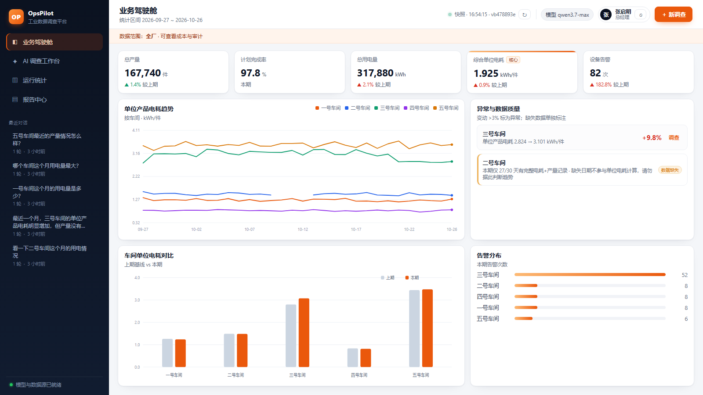
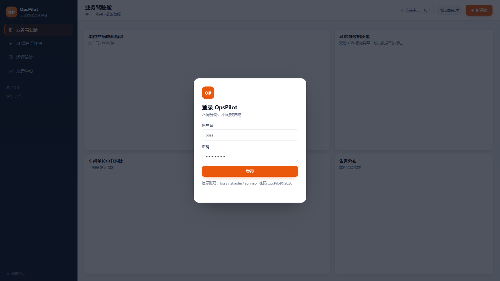
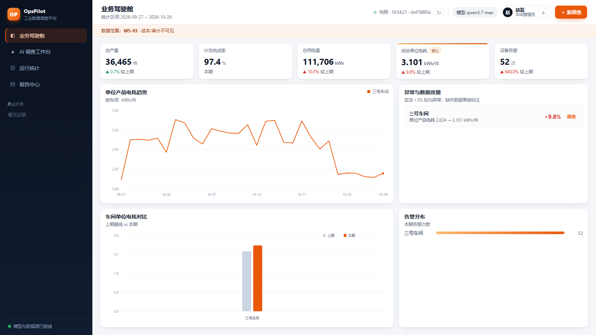
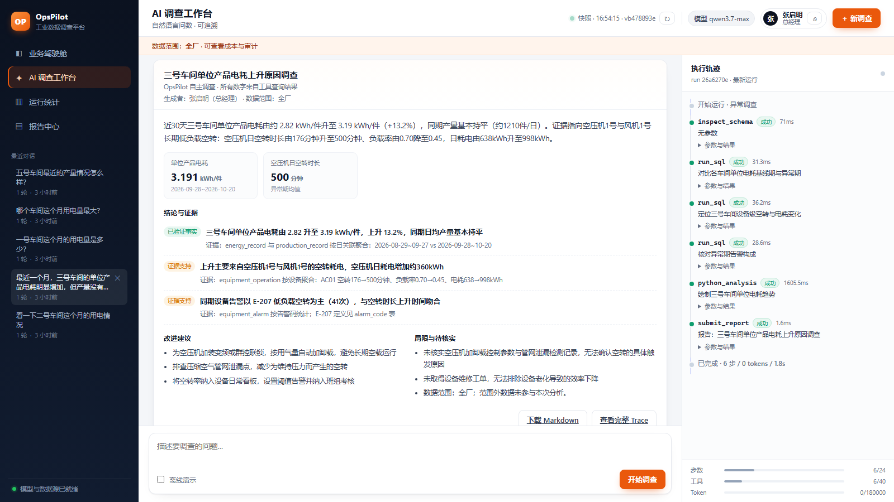
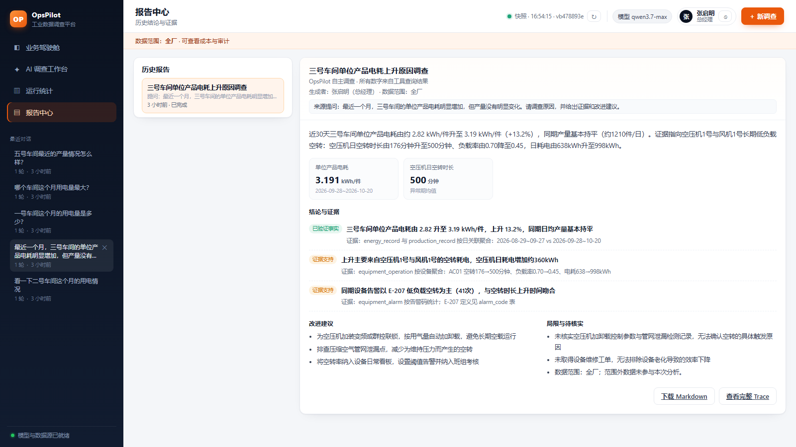
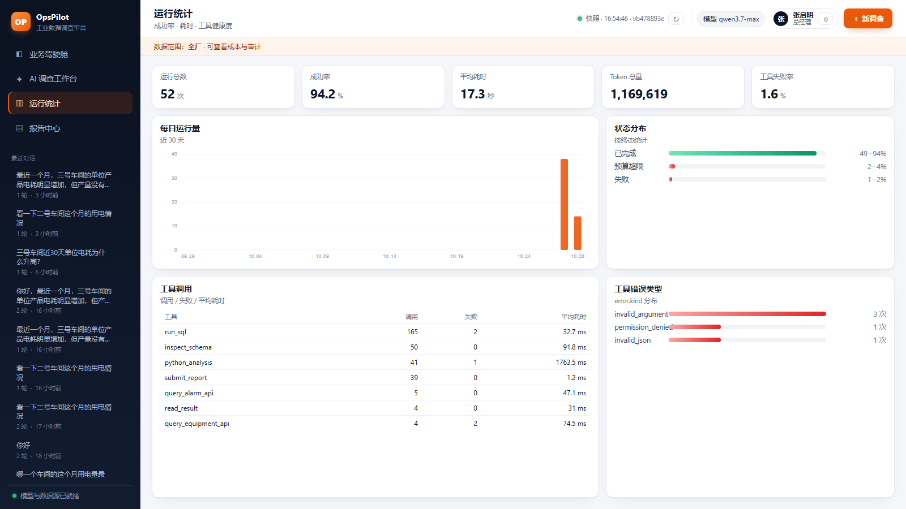
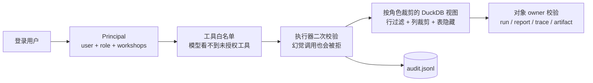

<div align="center">


# OpsPilot

**让制造数据自己开口说话。**

面向工厂多源数据的自主调查 Agent · 自研 Agent Loop + Harness · 内建多角色数据权限

[](https://www.python.org/)
[](https://fastapi.tiangolo.com/)
[](https://duckdb.org/)
[](docs/)
[](docs/)

问一句：**“最近一个月，三号车间的单位产品电耗明显增加，但产量没有明显变化，为什么？”**

它会自己决定查哪张表、调哪个接口、跑什么代码，逐层下钻到设备与日期，
把每一步决策、参数、结果、错误和重试摊开给你看，最后交出一份**带证据、带局限、可追溯**的调查报告。

[快速开始](#-快速开始) · [系统展示](#-系统展示) · [权限设计](#-权限设计) · [架构](#-架构) · [工程细节](#-工程细节)

</div>

---



## 🧭 为什么是 OpsPilot

制造企业从不缺数据，缺的是**把数据变成结论的那条路径**。

- 能耗、产量、设备、告警、成本散落在 MES / ERP / Excel / 时序库里；
- 一个“单位电耗为什么升高”的问题，往往要分析师花半天写 SQL、对口径、翻告警、画图；
- 更麻烦的是权限：**同一张表，老板能看全厂和成本，车间主任只能看自己车间、看不到成本**；
- 而直接把数据库交给大模型，又会遇到参数幻觉、越权查询、上下文爆炸、结论不可复核。

OpsPilot 把这件事拆成三层工程问题，并给出了可运行的答案：

| 问题 | OpsPilot 的答案 |
|---|---|
| 模型会不会乱查、查不全、停不下来？ | **Agent Loop**：任务分级预算、逐步取证、预算提醒、循环熔断、断点续跑 |
| 工具调用失败了怎么办？ | **Tool Harness**：Pydantic Schema、参数自动修复、11 类错误、超时/重试/审计 |
| 模型能不能看到不该看的数据？ | **Permission Layer**：角色工具白名单、按角色裁剪的 DuckDB 视图、行/列/表/对象四道闸 |

> 数据为**合成制造数据**，仅用于演示调查流程与权限边界，不代表任何真实工厂。

---

## ✨ 它到底能做什么

### 1. 自主调查，而不是“Text-to-SQL 一把梭”

OpsPilot 不会拿到问题就拼一条 SQL。它按 **Plan → Act → Observe → Reflect** 循环：

1. `inspect_schema` 看表结构、枚举值、时间覆盖；
2. 用 SQL 确认现象、定位时间窗；
3. 下钻设备（空转率、负载率、能耗）与告警；
4. 交叉验证（SQL 聚合 vs 业务 API、总量 vs 分项）；
5. `submit_report` 输出结构化报告，显式终止。

每一步都有预算和证据门槛：**简单查询**走 6 步 / 8 次工具 / 80k tokens 的紧预算；
**异常调查**走 24 步 / 40 次工具 / 180k tokens，并在消耗 50% 时提醒模型收尾。

### 2. 结论必须能回到证据

- 报告是**强 Schema**：摘要、关键指标、结论（已验证事实 / 证据支持 / 待核实）、建议、局限；
- 每条结论必须附 `evidence`，写清楚来自哪张表、哪个时间窗、哪次聚合；
- 全链路 **Trace**（决策、参数、结果、耗时、错误、重试）落盘，可在界面逐条展开；
- 报告是**快照**：数据更新不会改写历史结论，导出 Markdown 也带运行元信息。

### 3. 权限不是提示词，是数据出口

- 3 个演示账号、2 个角色：总经理 / 车间管理员；
- 车间管理员登录后，驾驶舱只出现自己车间，成本字段与成本表直接不可见；
- SQL 在**按角色裁剪的 DuckDB 视图**上执行，模型看不到越界行；
- 越权调用会被执行器拒绝并写入审计日志，而不是靠“请不要查别的车间”；
- 会话、报告、Trace、产物都按 `owner` 隔离，换一个账号打不开你的报告。

### 4. 面向真实故障设计，而不是只跑 Happy Path

- 工具参数错误自动修复（枚举、日期、数字字符串、单值转数组…）；
- 11 类错误分类，区分“模型改参数”还是“系统重试”；
- 超时、退避重试、循环熔断、上下文压缩；
- 大结果**不静默截断**：SQL 落 parquet + 统计 + 头尾样本 + `result_ref`，Python stdout 落盘，模型按需翻页；
- 进程重启后自动把 `running` 标为 `interrupted`，界面一键续跑；
- 跨轮上下文继承，支持“那五号车间呢？”这类追问。

---

## 📸 系统展示

### 登录：不同身份，看到不同的世界

<table>
<tr>
<td width="50%"></td>
<td width="50%"></td>
</tr>
<tr>
<td align="center"><sub>签名 Cookie 登录 · 演示账号一键体验</sub></td>
<td align="center"><sub>车间管理员：只看 WS-03，成本 / 审计不可见</sub></td>
</tr>
</table>

### 调查工作台：左边对话，右边证据



> 报告里的每个数字都能在右侧执行轨迹里找到对应的工具调用；
> 顶部明确标注“生成者 / 数据范围”，报告不是模型自说自话。

### 报告中心：结论、证据、局限一页看清



### 运行统计：把 Agent 当成一个系统来运维



> 成功率、耗时、Token、工具失败率、错误类型分布——模型不是黑盒，Harness 的健康度要能被看见。

---

## 🔐 权限设计

### 两个角色，六个维度

| 维度 | 总经理 `boss` | 车间管理员 `zhaolei` / `sunhao` |
|---|---|---|
| **数据行** | 全厂 5 个车间 | 仅本人车间（WS-03 / WS-05） |
| **数据列** | 全部（含 `cost_cny`） | `energy_record` 不含成本列 |
| **数据表** | 含 `workshop_cost` | 无 `workshop_cost` |
| **工具** | 10 个（含 `query_cost_summary`） | 9 个（无成本工具） |
| **对象** | 自己的会话 / 报告 / Trace | 自己的会话 / 报告 / Trace |
| **审计** | 可读 `/api/audit` | 不可读 |

### 四道闸，而不是一句 Prompt



- **工具层**：工具 Schema 按角色生成；即使模型凭空调用 `query_cost_summary`，执行器也会拒绝。
- **数据层**：每个请求一个内存 DuckDB，`ATTACH` 只读原始库，再创建带 `WHERE workshop_id IN (...)` 的临时视图；
  Python 沙箱拿到的是同样裁剪后的 `scoped.duckdb` 快照，堵住“绕过 SQL 工具”的旁路。
- **对象层**：会话、报告、Trace、图片全部校验 `owner`；越权访问统一返回 404，避免枚举。
- **审计层**：登录、越权、删除、导出都写 JSONL，老板可读，车间管理员不可读。

### 现场验证（30 秒）

1. 用 `zhaolei` 登录：驾驶舱只剩三号车间，趋势图只有一条线；
2. 问“五号车间这个月用电量多少？”：工具返回 `permission_denied`，Trace 里能看到拒绝原因；
3. 问“三号车间这个月成本是多少？”：工具列表里根本没有成本工具；
4. 用 `boss` 登录后访问 `/api/audit`，能看到刚才的拒绝记录。

```bash
# 登录并读取审计（macOS / Linux；Windows 用 curl.exe）
curl -c cookies.txt -X POST http://127.0.0.1:8100/api/auth/login \
  -H 'Content-Type: application/json' \
  -d '{"username":"boss","password":"OpsPilot@2026"}'

curl -b cookies.txt http://127.0.0.1:8100/api/audit
```

> 这是**演示级认证**：静态用户 + scrypt + HMAC 签名 Cookie，没有用户表、没有服务端吊销、没有登录限流。
> 生产主要替换 `current_principal`（以及用户源）：换成 OIDC/JWT 后，下游 Principal、ROLES、数据视图、执行器完全不用动。

---

## 🏗 架构

```mermaid
flowchart TB
    subgraph Browser["浏览器 · 原生 JS / 手写 SVG"]
        UI[驾驶舱 · 调查工作台 · 报告中心 · 运行统计]
    end

    UI -->|签名 Cookie| API[FastAPI<br/>认证 · Origin Guard · SSE]
    API --> P[Principal<br/>角色 + 车间域]
    P --> LOOP[Agent Loop<br/>路由 · 预算 · 检查点 · 续跑]

    LOOP --> LLM[OpenAI 兼容模型<br/>function calling]
    LOOP --> EXEC[Tool Harness<br/>Schema · 修复 · 超时 · 重试 · 审计]

    EXEC --> SQL[Scoped DuckDB 视图<br/>行 / 列 / 表裁剪]
    EXEC --> ERP[模拟 ERP / MES API<br/>scope binder]
    EXEC --> PY[Python 沙箱<br/>scoped.duckdb 快照]
    EXEC --> REPORT[submit_report<br/>强 Schema + owner 盖章]

    LOOP --> TRACE[(Trace JSONL)]
    LOOP --> STATE[(SQLite 状态库<br/>checkpoint / resume)]
    SQL --> DB[(合成制造数据库<br/>5 车间 · 120 天)]
    REPORT --> STATE
```



### 技术栈

| 层 | 选型 | 为什么 |
|---|---|---|
| Web / API | FastAPI + Uvicorn | 流式 SSE、依赖注入、类型友好 |
| Agent | **自研 Loop + Harness** | 预算、错误分类、检查点、权限都要能改到字节级 |
| 模型 | 任意 OpenAI 兼容端点 | 已在 qwen3.7-max / plus / flash 实测 function calling |
| 数据 | DuckDB | 单文件、列存、窗口/分位函数全，适合分析型 Agent |
| 数据访问 | 按角色内存视图 | 权限在数据出口，不在提示词 |
| 前端 | 原生 HTML / CSS / JS + SVG | 无构建、无 CDN，内网/离线可用 |
| 沙箱 | 子进程 / Docker（可选） | 开发机轻量，生产可切容器 |
| 状态 | SQLite | 单机零依赖，支持检查点与多轮 |

---

## 🚀 快速开始

### 环境要求

- Python **3.11+**
- Windows / macOS / Linux
- 不需要 Docker，不需要 Node.js，不需要单独安装数据库

### 一条命令跑起来

```bash
git clone https://github.com/<your-name>/OpsPilot.git
cd OpsPilot

python -m venv .venv
# Windows PowerShell
.venv\Scripts\Activate.ps1
# macOS / Linux
source .venv/bin/activate

pip install -e .

# 首次运行会从 .env.example 生成 .env
python scripts/run_demo.py
```

脚本会自动完成：

1. 数据库不存在时生成 120 天合成数据；
2. 启动模拟 ERP（`127.0.0.1:8101`）；
3. 启动 OpsPilot Web（`127.0.0.1:8100`）；
4. 打开浏览器。

### 演示账号

| 用户名 | 姓名 | 角色 | 数据范围 |
|---|---|---|---|
| `boss` | 张启明 | 总经理 | 全厂 5 个车间 + 成本 + 审计 |
| `zhaolei` | 赵磊 | 车间管理员 | 仅 WS-03，无成本 |
| `sunhao` | 孙浩 | 车间管理员 | 仅 WS-05，无成本 |

**密码：`OpsPilot@2026`**（可在 `.env` 中用 `OPSPILOT_DEMO_PASSWORD` 修改）

### 没有模型 Key？

登录后勾选输入框下方的 **「离线演示」**，再点击「开始调查」。
它会用脚本化决策跑通完整链路：schema → SQL → Python → 告警 API → 报告，
让你在没有 API Key 的情况下也能看到产品全貌。

### 配置真实模型

编辑 `.env`：

```ini
# DeepSeek
OPSPILOT_LLM_BASE_URL=https://api.deepseek.com/v1
OPSPILOT_LLM_API_KEY=sk-...
OPSPILOT_LLM_MODEL=deepseek-chat

# 或阿里云百炼 / MAAS（OpenAI 兼容端点）
# OPSPILOT_LLM_BASE_URL=https://dashscope.aliyuncs.com/compatible-mode/v1
# OPSPILOT_LLM_MODEL=qwen3.7-max
```

### 手动启动（两个终端）

```bash
# 终端 1
python -m opspilot.data.seed          # 可选：重新生成数据
python -m opspilot.mock_erp.app

# 终端 2
python -m uvicorn opspilot.api.app:app --host 127.0.0.1 --port 8100
```

### 推荐的第一条调查

> 最近一个月，三号车间的单位产品电耗明显增加，但产量没有明显变化。请调查原因，并给出证据和改进建议。

你会看到它：

- 用 `inspect_schema` 确认口径与枚举；
- 用 SQL 找到 **2026-09-28** 这个拐点；
- 下钻到空压机 `EQ-WS03-AC01` 与风机 `EQ-WS03-FAN01`；
- 发现空转时长从 176 分钟升到 500 分钟、负载率从 0.70 降到 0.45；
- 用告警 API 交叉验证 `E-207 低负载空转`；
- 输出报告，并把“未核实项”写进局限。

---

## ⚙️ 配置项

| 变量 | 默认值 | 说明 |
|---|---|---|
| `OPSPILOT_LLM_BASE_URL` | `https://api.deepseek.com/v1` | OpenAI 兼容端点 |
| `OPSPILOT_LLM_API_KEY` | 空 | 为空时只能离线演示 |
| `OPSPILOT_LLM_MODEL` | `deepseek-chat` | 模型名 |
| `OPSPILOT_MAX_STEPS` | `24` | 调查类最大步数 |
| `OPSPILOT_MAX_TOOL_CALLS` | `40` | 最大工具调用次数 |
| `OPSPILOT_MAX_TOKENS` | `180000` | 单次运行 token 预算 |
| `OPSPILOT_MAX_SECONDS` | `900` | 单次运行时间上限 |
| `OPSPILOT_SANDBOX` | `subprocess` | `subprocess` / `docker` |
| `OPSPILOT_SESSION_SECRET` | 空 | 生产必须配置；为空时进程内随机 |
| `OPSPILOT_DEMO_PASSWORD` | `OpsPilot@2026` | 演示账号密码 |
| `OPSPILOT_COOKIE_SECURE` | `false` | HTTPS 部署时设为 `true` |
| `OPSPILOT_ALLOWED_ORIGINS` | `http://127.0.0.1:8100,...` | Origin 白名单 |

完整列表见 `.env.example`。

---

## 📦 项目结构

```text
OpsPilot/
├── opspilot/
│   ├── core/                 # Agent Loop、事件、任务路由、提示词
│   ├── harness/              # 工具注册/执行、错误、预算、上下文、沙箱、状态、Trace
│   ├── security/             # Principal、角色、签名 Cookie、Scoped DuckDB、审计
│   ├── modules/
│   │   ├── dashboard/        # 驾驶舱聚合、数据版本
│   │   ├── metrics/          # 指标口径、运行统计
│   │   └── reporting/        # 报告去重与 Markdown 导出
│   ├── tools/                # schema / SQL / API / Python / 报告 / 成本 / 结果翻页
│   ├── api/                  # FastAPI 路由、SSE、鉴权
│   ├── frontend/             # 原生前端（无构建、无 CDN）
│   ├── mock_erp/             # 模拟 MES / ERP / 告警 API
│   ├── data/                 # 合成数据生成器
│   └── cli.py                # 命令行调查入口
├── data/opspilot.duckdb      # 开箱即用的合成数据库
├── docs/screenshots/         # 系统截图
├── infra/sandbox.Dockerfile  # 可选沙箱镜像
├── scripts/run_demo.py       # 一条命令启动
├── .env.example
├── pyproject.toml
└── requirements.txt
```

---

## 🔬 工程细节

### Agent Loop：把“自主”关进笼子

- **任务路由**：关键词 + 任务形态判断 `simple` / `investigation`，两套预算，避免简单问题过度调查；
- **预算闸门**：步数、工具次数、token、耗时四道硬限制；消耗 50% 时注入系统提醒；
- **循环熔断**：同一工具连续失败会提示模型换路径，而不是无限重试；
- **检查点**：每步落库，进程重启后标记 `interrupted`，可从断点继续；
- **跨轮上下文**：同一会话注入最近几轮的“任务 + 报告摘要”，支持指代与追问；
- **优雅降级**：模型输出非法 JSON 时先清洗再回填，避免整轮崩掉。

### Tool Harness：让工具调用可诊断

| 能力 | 做法 |
|---|---|
| Schema 约束 | Pydantic 模型生成 JSON Schema，枚举值在 `inspect_schema` 里直接给出 |
| 参数修复 | 单值→数组、数字字符串、日期格式、枚举别名等确定性修复 |
| 错误分类 | `invalid_json` / `invalid_argument` / `permission_denied` / `timeout` / `execution_error` … |
| 重试策略 | 按错误类型决定“让模型改”还是“系统重试”，带退避 |
| 结果不丢 | 大 SQL 结果落 parquet + 统计 + 引用；Python stdout 落盘；`read_result` / `read_artifact` 翻页 |
| 可观测 | 每次调用记录耗时、重试、错误、产物；运行统计页汇总失败率 |

### 权限：四个必须同时成立的判断

```text
能登录（签名 Cookie）
  ∧ 角色允许这个工具（tool whitelist）
  ∧ 数据域允许这个车间（scoped views / scope binder）
  ∧ 对象属于当前用户（owner check）
```

任何一条不成立，请求就失败；失败会进审计，而不是“悄悄返回空结果”。

### 数据故事：不是随机数

| 埋点 | 用途 |
|---|---|
| WS-03 从 2026-09-28 起空压机/风机低负载空转 | 主异常，考验逐层下钻与交叉验证 |
| WS-02 在 2026-10-10 ~ 10-12 缺失电耗 | 考验数据质量判断与诚实表达 |
| WS-05 从 10 月起不良率上升 | 干扰项，防止把“相关”当“因果” |
| 日常温度/振动告警噪声 | 考验告警筛选，而不是“有告警就归因” |

数据规模：5 个车间、120 天、17 台设备、约 4,800 条业务记录、182 条告警、25 条月度成本。

---

## ⚠️ 边界与取舍

OpsPilot 是一个**可运行的工程演示**，不是生产系统：

- **认证**：静态用户 + 签名 Cookie，无用户表 / 会话吊销 / 登录限流；生产应接 OIDC。
- **SQL 防护**：按角色视图 + 词法 guard，不是完整 AST 防火墙；高安全场景可替换为 `sqlglot` AST 重写。
- **沙箱**：默认子进程隔离，**不是安全边界**；生产应使用 Docker / gVisor，并限制网络与资源。
- **数据**：全部为合成数据，不能用于真实生产决策。
- **并发**：单机 Demo，没有多租户并发配额、限流与优雅停机；这些属于部署层。
- **模型**：调查质量依赖模型的 function calling 稳定性；不同模型表现会有差异。

这些不是“藏起来的坑”，而是刻意保留的**演进接口**。

---

## 🗺 Roadmap

- [ ] OIDC / JWT 登录，替换演示用户
- [ ] 写操作工具 + HITL 审批（工单、排产建议）
- [ ] Docker 沙箱镜像与网络隔离
- [ ] 多租户并发配额、限流、优雅停机
- [ ] Prometheus 指标导出与 Trace 可视化
- [ ] 评测集：调查正确率、工具效率、越权拦截率
- [ ] 真实数据集适配（UCI Steel Energy / AI4I）

---

## 🤝 贡献与 Star

如果 OpsPilot 让你对“Agent 如何真正落到工业场景”有了新的想法，欢迎：

- ⭐ **Star** 这个仓库，让更多做制造数据的人看到；
- 🐛 提 Issue：说出你遇到的脏数据、怪权限、模型幻觉；
- 🔧 提 PR：新的工具、新的数据源、新的评测任务都欢迎。

<div align="center">

**把“为什么”交给数据，把证据链留给人。**

<sub>OpsPilot · Built with FastAPI, DuckDB and a lot of carefully placed guardrails.</sub>

</div>
