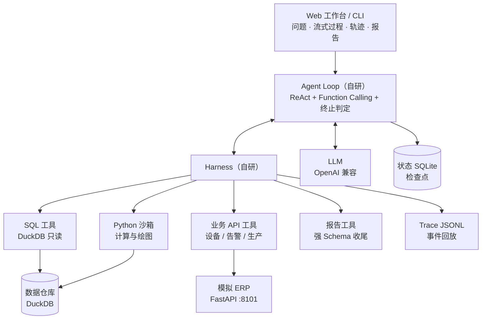
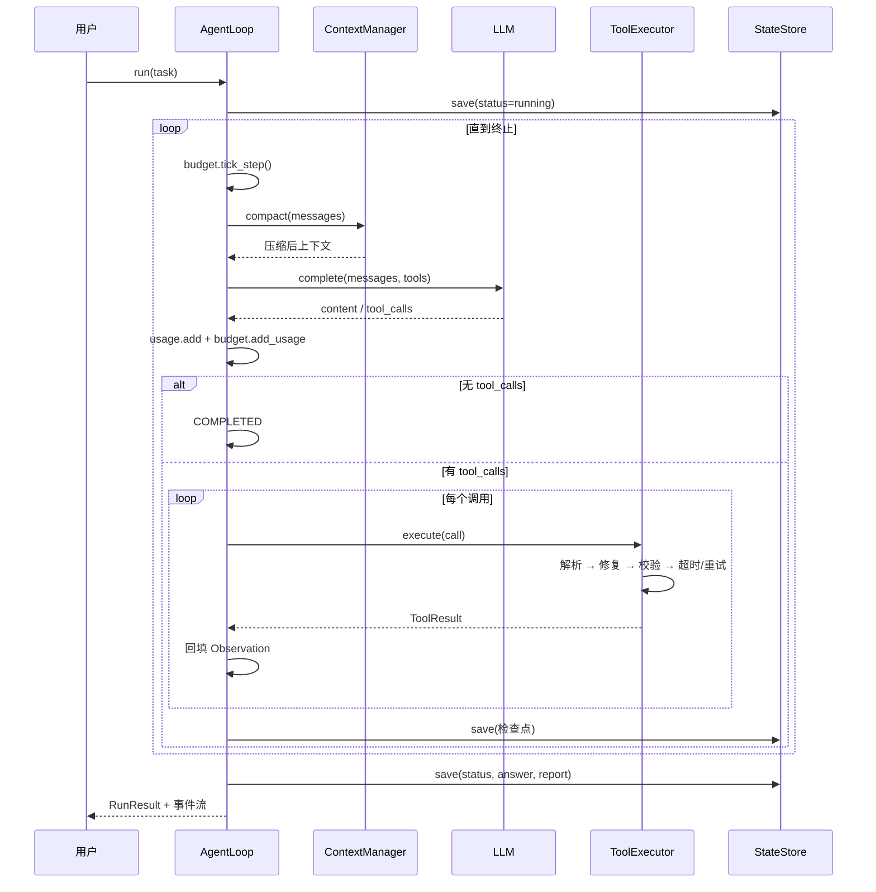
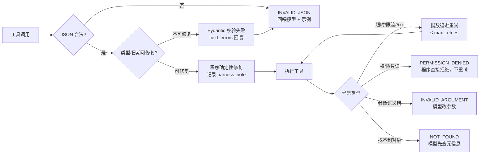
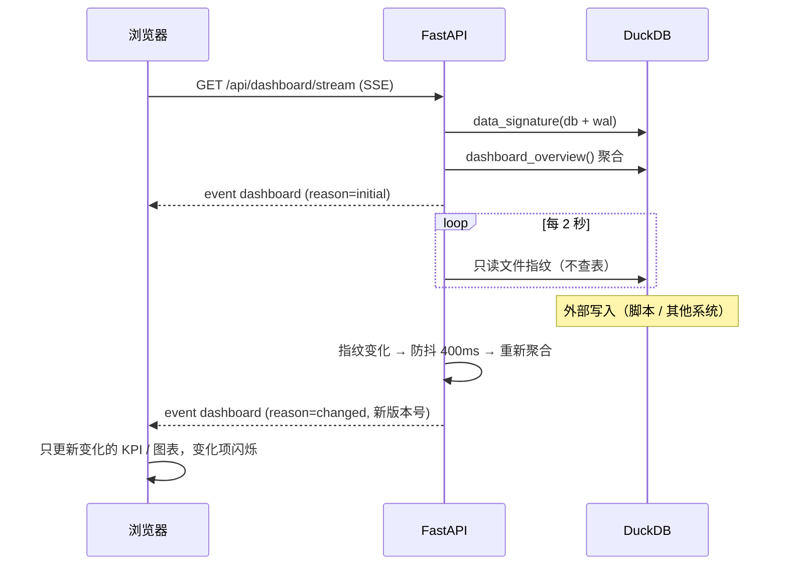

# OpsPilot · 架构说明

## 1. 总体分层

设计原则：**Loop 只负责决策推进，Harness 负责让每次工具调用可控、可观测、可恢复。**
两者之间只有 `ToolCall → ToolResult` 一个契约，因此加工具不需要改循环。

## 2. 一次 run 的时序

## 3. Harness 的错误处理边界

这是全项目最值得讲的设计：**不是所有错误都该交给模型。**

约束：

| 场景 | 处理者 | 原因 |
|---|---|---|
| 日期格式 `2026/9/1`、`"50"` → `50`、逗号串 → 数组 | 程序 | 确定性转换，省一次模型往返 |
| 缺失必填字段、枚举/编号不存在 | 模型 | 需要语义判断 |
| 只读环境里的写操作 | 程序 | 直接拒绝，不给模型"再试一次"的机会 |
| 超时、429、5xx | 程序（有限重试） | 瞬时故障，退避即可 |
| 同一调用连续失败 2 次 | Harness 熔断提示 | 防止模型陷入原地打转 |

## 4. 上下文与预算

- **单条工具输出**：超过 `tool_output_chars`（默认 4000）按 6:4 保头保尾截断，完整结果仍在 Trace 里。
- **整体历史**：当估算 token 超过 `context_token_budget × 0.72` 时，保留 system + 初始任务 + 最近 8 条，
  中间消息压缩成一条 `harness_summary`（列出调用过的工具与结果摘要）。
- **四道硬闸**：最大步数、最大工具调用数、最大 token、最大墙钟时间；任一超限都以结构化状态终止。
- **预算感知**：消耗达 60% 时注入一条系统提醒，要求尽快提交报告——解决"模型无限深挖"的现实问题。

### 4.1 任务分级

`core/routing.py` 用关键词把任务分成两档（拿不准按调查处理），`AgentLoop` 据此选择预算、
上下文窗口与提示词：

| 档位 | 步数 | 工具 | tokens | 上下文预算 | 提示词约束 |
|---|---|---|---|---|---|
| `simple` | 6 | 8 | 80k | 16k | 禁止画图、禁止交叉验证，1~2 条 SQL 直接回答 |
| `investigation` | 24 | 40 | 300k | 30k | 逐层下钻、交叉验证、`submit_report` |

分级是确定性的、可单测的，不额外消耗一次模型调用。理由：ReAct 的每一步都要重发全部历史，
"简单问题用调查流程"会把成本放大 2~3 倍（实测 12 步 75.8k tokens → 5 步 28.3k）。

## 5. 看板数据变更推送（SSE）

看板不是"定时全量刷新"，而是"数据变了才推一份新快照"：

- **版本号**：`v` + `sha1(主文件 mtime/size + WAL mtime/size)[:8]`，能捕捉尚未 checkpoint 的写入。
- **代价控制**：指纹相同则不重算、不推送；每 15 秒发一次 SSE 注释行保活；断线由 EventSource 自动重连。
- **并发**：DuckDB 单写多读，读侧遇到文件锁会重试 4 次；写侧建议用独立进程并自行处理锁冲突。
- **静态模式**：`/?static=1` 关闭长连接、只取一次快照——用于截图、打印和无 SSE 环境。
- **不重造历史**：历史报告是当时落库的 JSON 快照，数据更新不会改写已生成的报告。

## 6. 状态与恢复
每一步结束写一次检查点：`messages + step + usage + status`。

会话维度：`runs.session_id` 把同一段对话里的多轮 run 归在一起。侧栏按 session 聚合展示，
点开时按 `created_at` 顺序取出该 session 的全部 run 并重放各自的事件流；
新增提问沿用当前 `session_id`，因此不会每问一句就多出一个"对话"。

删除会话时：`runs` 行、报告、`runs/<run_id>/` 下的 Trace 与图表一起删除，
用户提问写入 `deleted_sessions` 归档（不保留回答与文件），前端把最后一句提问回填输入框。

- 崩溃/重启后 `POST /api/runs/{id}/resume` 从最后一条消息继续；
- 已完成/已取消的 run 拒绝续跑；
- `resume` 时预算计数从持久化状态恢复，不会"续跑即刷新预算"。

## 7. 安全边界（诚实版）

| 措施 | 现状 |
|---|---|
| SQL 只读 | 词法白名单 + DuckDB `read_only=True` + 行数上限 + 超时中断，三层 |
| 写操作 | 没有注册任何写入工具；SQL 中 DDL/DML 一律拒绝 |
| Python 沙箱 | 独立进程 + `-I` + 临时目录 + 超时强杀 + 输出截断；**这不是对抗恶意代码的强隔离** |
| 强隔离方案 | 配置 `OPSPILOT_SANDBOX=docker`，`--network none` + 内存/CPU 限制（需自建镜像） |
| 凭证 | 只在 `.env` / 环境变量，`.gitignore` 排除；前端不接触 |
| 认证/多租户 | **未实现**，当前定位是单机演示 |

## 8. 为什么不全用现成框架

借鉴说明里推荐 DB-GPT / Deep Agents，理由是"别重复造轮子"。本项目的取舍是：

- **复用**：LLM SDK、Pydantic、FastAPI、DuckDB、Docker、图表渲染。
- **自研**：Loop、工具注册/执行、错误恢复、上下文、状态、追踪。
  原因不是"框架不能用"，而是这六项正是本项目要展示的技术能力，也是后续消融实验的自变量。
- **对照**：`chAgent` 环境里同时装了 `langgraph`，后续可用同一任务集跑"框架版"做对照，
  验证自研 Harness 在异常恢复与成本上的差异。

## 9. 后续演进

1. **人工审批**：高风险工具（写操作、外部通知）挂起等用户确认，`PAUSED` 状态已预留。
2. **MCP / OpenAPI 自动注册**：从接口文档自动生成 `ToolSpec`，替代手写参数模型。
3. **消融实验**：固定 Workflow / 基础 ReAct / ReAct+恢复 / 完整 Harness 四组对比。
4. **Docker 沙箱镜像**：把 pandas/matplotlib 打进镜像，默认使用强隔离。
5. **多轮会话**：把 session 维度的历史带入下一次任务（当前每个 run 独立）。
